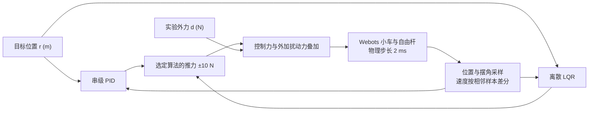

# 水平小车与一根自由摆杆

小车只沿世界坐标的 $+x$ 方向平移。铰轴平行 $+y$，竖直向上为 $+z$。杆直立时 $\theta=0$，杆顶向 $+x$ 偏斜时 $\theta>0$。给小车正向力会让直立杆相对小车向后倾，因此单位正推力对应正的小车加速度和负的摆角加速度。

| 符号 | 物理量 | 标称值 |
|---|---|---|
| $M$ | 小车质量 | 1.0 kg |
| $m$ | 摆杆质量 | 0.20 kg |
| $L$, $w$ | 均匀长方体的杆长、方截面边长 | 0.60 m、0.020 m |
| $l=L/2$ | 铰点至重心 | 0.30 m |
| $I_c=m(L^2+w^2)/12$ | 绕质心、平行铰轴的惯量 | 0.00600667 kg·m² |
| $J=I_c+m l^2$ | 绕铰轴惯量 | 0.02400667 kg·m² |
| $b$, $c$ | 滑轨黏性阻尼、铰轴黏性阻尼 | 0.05 N·s/m、0.002 N·m·s/rad |
| $g$ | 重力加速度 | 9.81 m/s² |

模型假定杆和车为刚体，滑轨水平，无侧向运动，关节摩擦用速度正比项近似。控制力 $u$ 和试验扰动力 $d$ 均沿滑轨方向作用在小车上。摆杆自由转动，铰点无主动执行器。改变杆长或质量时，同步更新几何、重心、惯量和关节运动关系。

## 从几何到运动方程

以铰点所在高度为势能零点，杆质心的水平、竖直坐标为 $x+l\sin\theta$、$l\cos\theta$。由平动与转动动能可得

$$
T=\tfrac12(M+m)\dot x^2+ml\dot x\dot\theta\cos\theta+\tfrac12 J\dot\theta^2,
\qquad V=mgl\cos\theta .
$$

广义力取 $Q_x=u+d-b\dot x$、$Q_\theta=-c\dot\theta$。将 $T-V$ 对 $x,\theta$ 使用拉格朗日方程，得

$$
\begin{bmatrix}
M+m & ml\cos\theta \\
ml\cos\theta & J
\end{bmatrix}
\begin{bmatrix}\ddot x\\\ddot\theta\end{bmatrix}
=
\begin{bmatrix}
u+d-b\dot x+ml\dot\theta^2\sin\theta \\
mgl\sin\theta-c\dot\theta
\end{bmatrix}.
$$

在直立平衡点附近取 $\sin\theta\approx\theta$、$\cos\theta\approx1$ 并舍去高阶乘积，令 $s=[x,\dot x,\theta,\dot\theta]^T$，得到 $\dot s=As+B(u+d)$。按表中标称值代入有

$$
A\approx\begin{bmatrix}
0&1&0&0\\
0&-0.047617&-1.400984&0.004760\\
0&0&0&1\\
0&0.119010&28.019676&-0.095208
\end{bmatrix},
\qquad
B\approx\begin{bmatrix}0\\0.952343\\0\\-2.380197\end{bmatrix}.
$$

连续开环有一个约 $+5.243\,\mathrm{s}^{-1}$ 的实极点，因此无反馈的小偏角会放大。在原点施加 +1 N 的初始加速度应约为 $+0.952\,\mathrm{m/s^2}$ 和 $-2.380\,\mathrm{rad/s^2}$。运行 `python tools/model.py` 可用中心差分从非线性方程独立核验解析 $A,B$ 的全部元素。

## 信号流与采样

控制器每 4 ms 读取一次位置和摆角，两个相邻样本得到线速度与角速度。初次采样速度取零。每个控制输出保持两个物理步；实验外力单独施加。角速度的内部单位为 rad/s，角度比较时从 rad 换算为度。
