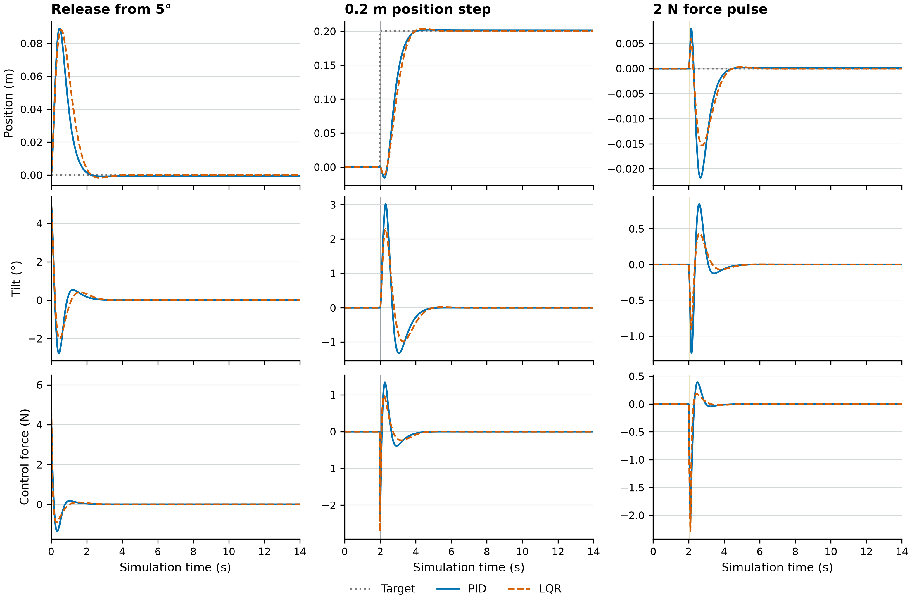
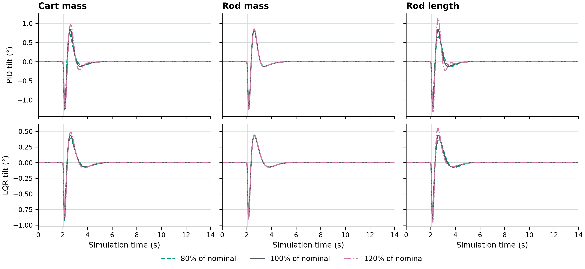
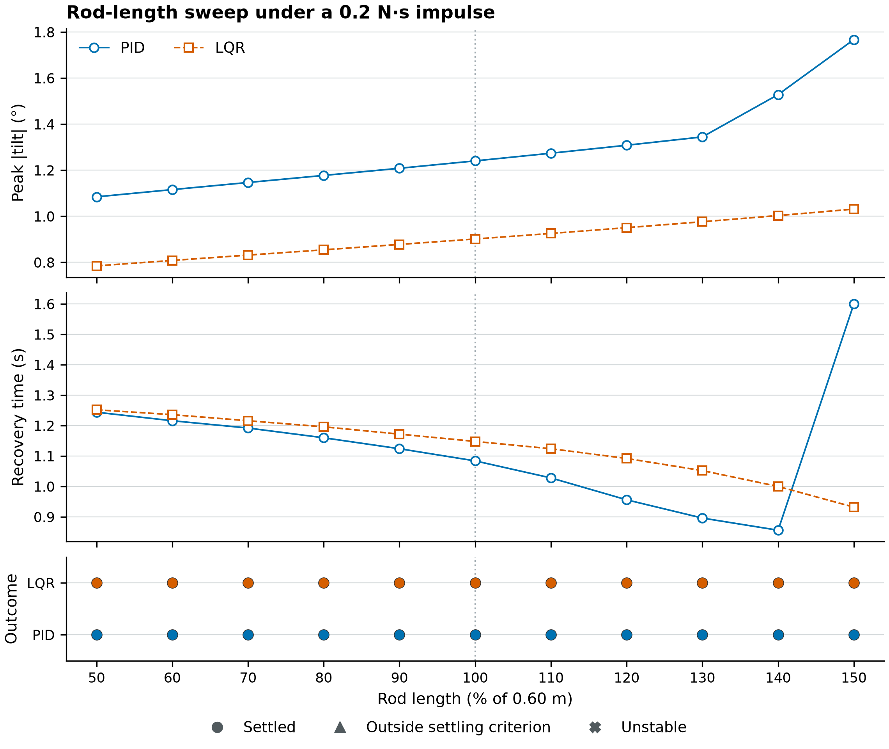

# 倒立摆小车仿真实验结果

共分析 34 次 Webots 运行。每条曲线来自一次确定性运行。两种算法共用 4 ms 采样、±10 N 控制力限幅和相同初始条件。原始记录与实验参数可按运行编号对应。[原始 CSV](../evidence/raw/) · [工况清单](../experiments/manifest.json) · [完整指标表](../evidence/summary.csv)

## 验收口径

- 每次观察 14 s。位置误差≤0.01 m 且绝对摆角≤1°，连续保持到观察结束并至少保持 0.5 s，记为已恢复。调节时间从初始释放、阶跃生效或脉冲撤除起算。其余完成全窗的运行记为观察窗内未恢复。
- 遇到绝对摆角≥30°、绝对位移≥1.5 m 或非有限值即判失稳，保留已观测数据。图中提前终止的曲线只画至最后一个有效样本。
- 峰值从事件开始计，控制力均方根按同一段采样时间计算。末段误差取完整运行最后 0.5 s 的位置减目标均值。正超调以 0.2 m 阶跃幅值为分母。

## 标称模型

| 工况 | 算法 | 状态 | 调节时间 (s) | 峰值摆角 (°) | 最大绝对位移 (m) | 峰值控制力 (N) | 均方根控制力 (N) |
| --- | --- | --- | ---: | ---: | ---: | ---: | ---: |
| 5° 初偏角 | PID | 已恢复 | 1.520 | 5.001 | 0.089 | 4.800 | 0.335 |
| 5° 初偏角 | LQR | 已恢复 | 1.784 | 5.001 | 0.088 | 6.123 | 0.321 |
| 位置阶跃 | PID | 已恢复 | 1.588 | 3.014 | 0.202 | 2.420 | 0.238 |
| 位置阶跃 | LQR | 已恢复 | 1.672 | 2.290 | 0.204 | 2.713 | 0.193 |
| 外力脉冲 | PID | 已恢复 | 1.084 | 1.241 | 0.022 | 2.095 | 0.198 |
| 外力脉冲 | LQR | 已恢复 | 1.148 | 0.901 | 0.015 | 2.291 | 0.188 |

阶跃在 2.000 s 生效。
PID 的正超调为 1.12%，末段有符号平均位置误差为 0.001508 m。
LQR 的正超调为 1.92%，末段有符号平均位置误差为 0.000000 m。

灰色点线为位置目标。竖线标出阶跃时刻，浅色区标出 2 N 水平外力从 2.000 到 2.100 s 的作用时间。按相邻采样时刻间隔积分，PID 和 LQR 记录的外力冲量分别为 0.200 与 0.200 N·s。

## 单参数摄动

保持两组控制增益固定，分别改变实际小车质量、杆质量和杆长，各运行一次相同的外力脉冲。每个面板给出相同算法的三条实测角度曲线。

| 参数比例 | 算法 | 状态 | 峰值摆角 (°) | 恢复用时 (s) |
| --- | --- | --- | ---: | ---: |
| 小车质量 80% | PID | 已恢复 | 1.276 | 1.124 |
| 小车质量 80% | LQR | 已恢复 | 0.919 | 1.164 |
| 小车质量 120% | PID | 已恢复 | 1.211 | 1.044 |
| 小车质量 120% | LQR | 已恢复 | 0.885 | 1.136 |
| 杆质量 80% | PID | 已恢复 | 1.240 | 1.088 |
| 杆质量 80% | LQR | 已恢复 | 0.901 | 1.152 |
| 杆质量 120% | PID | 已恢复 | 1.242 | 1.076 |
| 杆质量 120% | LQR | 已恢复 | 0.902 | 1.148 |
| 杆长 80% | PID | 已恢复 | 1.177 | 1.160 |
| 杆长 80% | LQR | 已恢复 | 0.854 | 1.196 |
| 杆长 120% | PID | 已恢复 | 1.308 | 0.956 |
| 杆长 120% | LQR | 已恢复 | 0.950 | 1.092 |

## 杆长扫描与算法选择

在相同脉冲下将杆长从 0.30 m 扫到 0.90 m，间隔 0.06 m。标称长度为 0.60 m。下表按占标称长度的百分比列出相邻试验点；点间隔为 10 个百分点。结论只覆盖这些离散长度与本次扰动。

| 算法 | 已恢复的试验点 | 观察窗内未恢复 | 失稳 |
| --- | --- | --- | --- |
| PID | 50%–150% | 无 | 无 |
| LQR | 50%–150% | 无 | 无 |

- 阶跃调节时间为 PID 1.588 s，LQR 1.672 s，PID 更低。
- 标称扰动峰值摆角为 PID 1.241 °，LQR 0.901 °，LQR 更低。
- 标称扰动均方根控制力为 PID 0.198 N，LQR 0.188 N，LQR 更低。

串级 PID 便于分别调整位置环和姿态环。离散 LQR 利用线性模型联合权衡四个状态与输入。
对于以标称位置跟踪为主的任务，优先选用 PID。该算法通过三项标称恢复判据，位置阶跃调节时间为 1.588 s。换装不同长度的摆杆时，应另按扫描表选择。
